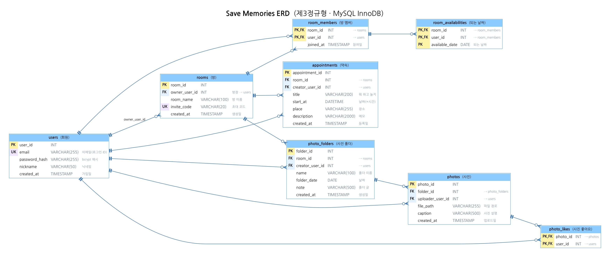
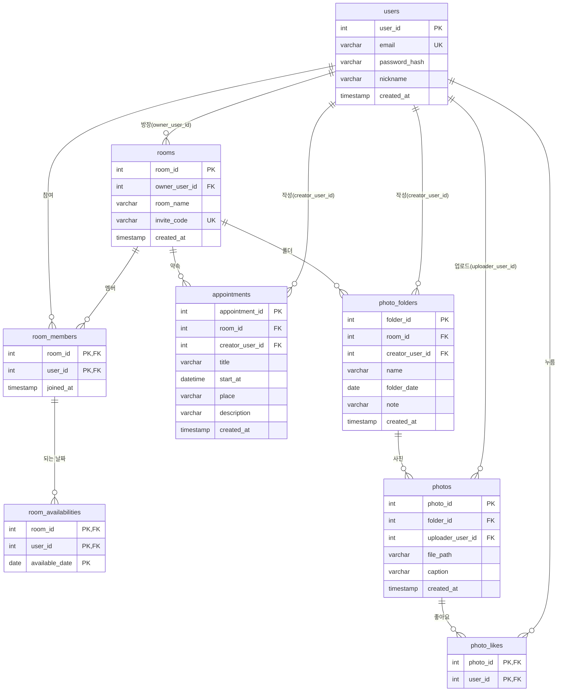

# Save Memories

> 친구들과 **방**을 만들어 약속 **날짜를 맞추고**, 날짜별 **사진 폴더**로 추억을 저장하는 웹 서비스

| | |
|---|---|
| 팀 / 역할 | (팀원 이름과 맡은 역할을 입력하세요) |
| 기술 | Node.js · Express 5 · MySQL(InnoDB) · Vanilla JavaScript |
| DB | 제3정규형(3NF), 테이블 8개, 모든 관계에 외래키 적용 |

## 주요 기능

| 기능 | 설명 |
|---|---|
| 회원가입 / 로그인 | 이메일 + 비밀번호(bcrypt 해시), 세션 로그인 |
| 방 만들기 | + 버튼 한 번으로 방 생성, 랜덤 초대 코드와 초대 링크 자동 발급 |
| 방 참여 | 초대 링크로 접속하거나 코드를 입력해서 참여 |
| 방 나가기 | 방장이 나가면 다음 멤버에게 방장 위임, 마지막 멤버가 나가면 방 삭제 |
| 날짜 정하기 | 달력에서 되는 날짜를 누르면 멤버별 색상 점으로 표시, 모두 되는 날은 강조, 겹치는 날 추천 |
| 약속 | 날짜 + 뭐 하고 놀지 + 장소 + 메모를 정리하고 수정/삭제, 목록 "더보기.." |
| 사진 폴더 | 날짜별 폴더를 만들고 폴더 안에 사진 여러 장 업로드 |
| 사진 상세 | 좋아요, 설명 수정, 삭제, 다운로드 |

## 실행 방법

필요한 것: **Node.js 18 이상**, **MySQL 8.x**(또는 MariaDB 10.x)

```bash
# 1) 의존성 설치
npm install

# 2) DB 만들기 (테이블 + 샘플 데이터)
mysql -u root -p < database/save_memories.sql

# 3) 환경 설정 파일 만들기 → .env 안의 DB 계정/비밀번호를 내 환경에 맞게 수정
cp .env.example .env          # Windows: copy .env.example .env

# 4) 실행
npm start
```

브라우저에서 **http://localhost:3000** 접속

### 샘플 계정 (비밀번호는 모두 `password1234`)

| 이메일 | 닉네임 | 비고 |
|---|---|---|
| jisu@example.com | 지수 | "우리 셋의 방"(SAVE01) 방장 |
| minsu@example.com | 민수 | "동아리 모임"(CLUB22) 방장 |
| haeun@example.com | 하은 | |

샘플 방 `SAVE01`에는 세 명의 가능한 날짜, 약속 3개, 사진 폴더 2개(사진 4장)가 들어 있어요.

> 서버는 시작할 때 DB 구조가 설계(`database/save_memories.sql`)와 **정확히 같은지** 확인하고,
> 다르면 어떤 칼럼이 다른지 알려 준 뒤 종료해요.

## 데이터베이스 설계



<details>
<summary>Mermaid 버전 ERD (GitHub에서 바로 렌더링)</summary>


</details>

### 제3정규형 근거

- **1NF** : 모든 칼럼이 하나의 값만 가집니다. (날짜 목록을 한 칸에 쉼표로 넣지 않고 `room_availabilities` 행으로 분리)
- **2NF** : 복합키 테이블(`room_members`, `room_availabilities`, `photo_likes`)의 속성이 키 전체에 종속됩니다.
- **3NF** : 키가 아닌 속성끼리의 종속을 제거했습니다.
  - 방장은 `rooms.owner_user_id` **한 곳에만** 저장합니다. (`room_members.role`을 두면 같은 사실이 두 번 저장되어 수정 이상 발생)
  - 닉네임은 `users.nickname`에만 저장하고 `JOIN`으로 가져옵니다.
  - 사진이 속한 방은 `photos.room_id` 대신 `photos.folder_id → photo_folders.room_id`로만 알아냅니다. (이행 종속 제거)
  - 멤버별 색상은 저장하지 않고 참여 순서로 계산합니다.

### 무결성

- 모든 관계에 **외래키**를 설정했고, 방이 삭제되면 `ON DELETE CASCADE`로 멤버·약속·폴더·사진·좋아요가 함께 삭제됩니다.
- `room_availabilities`는 `(room_id, user_id)`가 **방 멤버일 때만** 저장되도록 `room_members`를 참조하고, 멤버가 방을 나가면 그 사람의 날짜도 함께 삭제됩니다.
- `users.email`, `rooms.invite_code`는 `UNIQUE`입니다.
- 방 생성/나가기/날짜 저장은 **트랜잭션**으로 처리합니다.

### DB 설계와 코드의 연결

| 테이블 | 사용하는 코드 | 기능 |
|---|---|---|
| users | `routes/auth.js`, `routes/users.js` | 회원가입, 로그인, 내 정보(가입일) |
| rooms | `routes/rooms.js` | 방 생성, 방 목록, 방장 위임, 방 삭제 |
| room_members | `routes/rooms.js` | 방 참여, 멤버 목록(참여일), 방 나가기, 접근 권한 검사 |
| room_availabilities | `routes/rooms.js` | 되는 날짜 저장/조회, 달력 표시 |
| appointments | `routes/appointments.js` | 약속 등록/조회/수정/삭제 |
| photo_folders | `routes/photos.js` | 날짜별 사진 폴더 |
| photos | `routes/photos.js` | 사진 업로드/조회/설명 수정/삭제 |
| photo_likes | `routes/photos.js` | 사진 좋아요 |

## API

모든 API는 `/api` 아래에 있고, 회원가입/로그인을 제외하면 로그인이 필요합니다.
방과 관련된 API는 **그 방의 멤버만** 사용할 수 있습니다.

| 분류 | 메서드 · 주소 | 설명 |
|---|---|---|
| 회원 | `POST /signup` `POST /login` `POST /logout` `GET /me` | 가입 · 로그인 · 로그아웃 · 내 정보 |
| 방 | `GET /rooms` `POST /rooms` | 내 방 목록 · 방 만들기 |
| | `POST /rooms/join` | 초대 코드로 참여 |
| | `GET /rooms/:roomId` | 방 정보 + 멤버 + 멤버별 되는 날짜 |
| | `PUT /rooms/:roomId/dates` | 내가 되는 날짜 저장 |
| | `POST /rooms/:roomId/leave` | 방 나가기 |
| 약속 | `GET` `POST /rooms/:roomId/appointments` | 목록 · 등록 |
| | `PUT` `DELETE /rooms/:roomId/appointments/:id` | 수정 · 삭제 |
| 폴더 | `GET` `POST /rooms/:roomId/folders` | 목록 · 만들기 |
| | `PUT` `DELETE /rooms/:roomId/folders/:id` | 수정 · 삭제 |
| 사진 | `GET /rooms/:roomId/photos?folder_id=` | 폴더 안 사진 목록 |
| | `POST /rooms/:roomId/photos` | 업로드 (`photo`, `folder_id`) |
| | `PUT` `DELETE /rooms/:roomId/photos/:id` | 설명 수정 · 삭제 |
| | `POST /rooms/:roomId/photos/:id/like` | 좋아요 켜기/끄기 |

## 보안

- 비밀번호는 **bcrypt**로 해시해서 저장합니다.
- 모든 SQL은 `?` 바인딩(Prepared Statement)을 사용해 **SQL 인젝션**을 막습니다.
- 화면에 글자를 넣을 때 `textContent`만 사용해 **XSS**를 막습니다.
- 로그인 시 세션을 새로 발급(`regenerate`)하고, 쿠키는 `httpOnly` + `sameSite=lax`입니다.
- 업로드는 JPG/PNG/WEBP, 5MB 이하만 허용하고, 저장 확장자는 파일 이름이 아니라 **검사한 MIME 타입**으로 정합니다.
- DB 비밀번호 등은 `.env`에 두고 `.gitignore`로 제외했습니다. (`.env.example`만 공개)

## 폴더 구조

```
├── server.js              서버 시작, 미들웨어, 라우터 연결
├── db.js                  MySQL 연결 풀 + DB 구조 검사
├── database/
│   └── save_memories.sql  테이블 설계 + 샘플 데이터
├── docs/
│   ├── ERD.png / ERD.svg  ERD
│   └── erd.dot            ERD 원본
├── routes/
│   ├── auth.js            회원가입 · 로그인 · 로그아웃
│   ├── users.js           내 정보
│   ├── rooms.js           방 · 멤버 · 되는 날짜 · 방 나가기
│   ├── appointments.js    약속
│   └── photos.js          사진 폴더 · 사진 · 좋아요
├── middleware/auth.js     로그인 확인
├── config/upload.js       사진 업로드 설정(multer)
└── public/                화면 (index.html, css, js, sample 사진)
```
